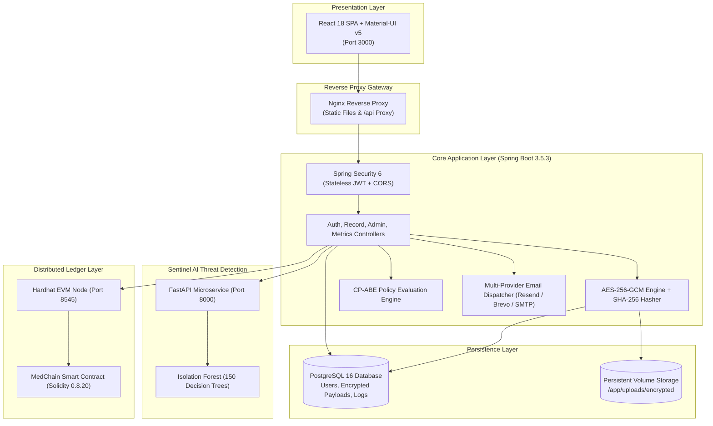
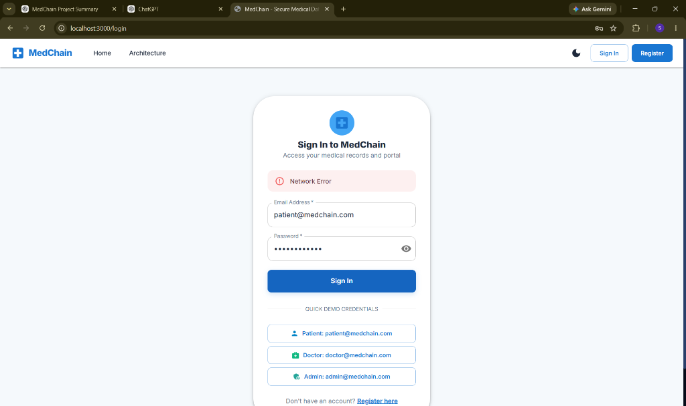
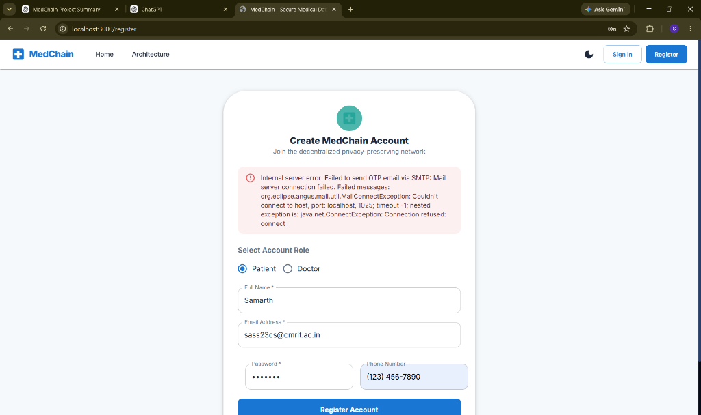

# MedChain — Blockchain-Aided Privacy-Preserving Medical Data Sharing with AI Anomaly Detection

[]()
[](https://spring.io/projects/spring-boot)
[](https://reactjs.org/)
[](https://fastapi.tiangolo.com/)
[](https://www.postgresql.org/)
[](https://soliditylang.org/)
[](https://www.docker.com/)
[](LICENSE)

> **Final Year Project Submission — Department of Computer Science & Engineering, CMR Institute of Technology (CMRIT)**  
> **Production Deployments**:  
> • **Frontend SPA**: [https://med-chain-amber.vercel.app](https://med-chain-amber.vercel.app)  
> • **Backend REST API**: [https://medchain-backend-kgmq.onrender.com](https://medchain-backend-kgmq.onrender.com)  
> • **Sentinel AI Microservice**: [https://medchain-sentinel-ml.onrender.com](https://medchain-sentinel-ml.onrender.com)  
> • **GitHub Repository**: [https://github.com/sh23cs-prog/MedChain](https://github.com/sh23cs-prog/MedChain)

---

## 📖 Table of Contents
1. [Project Overview](#-project-overview)
2. [Problem Statement](#-problem-statement)
3. [Project Objectives](#-project-objectives)
4. [Key Features](#-key-features)
5. [System Architecture](#-system-architecture)
6. [Technology Stack](#-technology-stack)
7. [Repository Structure](#-repository-structure)
8. [Docker Installation & Execution](#-docker-installation--execution)
9. [Local Development Instructions](#-local-development-instructions)
10. [Environment Variable Configuration](#-environment-variable-configuration)
11. [REST API Documentation & Endpoints](#-rest-api-documentation--endpoints)
12. [Database Setup & Schema](#-database-setup--schema)
13. [Machine Learning Sentinel AI & Dataset](#-machine-learning-sentinel-ai--dataset)
14. [Security & Cryptographic Architecture](#-security--cryptographic-architecture)
15. [Production Deployment Instructions](#-production-deployment-instructions)
16. [User Interface Walkthrough & Screenshots](#-user-interface-walkthrough--screenshots)
17. [Demo Video Presentation](#-demo-video-presentation)
18. [Contributors & Acknowledgements](#-contributors--acknowledgements)

---

## 🌟 Project Overview

**MedChain** is an enterprise-grade, privacy-preserving healthcare information platform designed to enable secure, patient-controlled medical record sharing across healthcare providers. By unifying **authenticated AES-256-GCM encryption**, **Ciphertext-Policy Attribute-Based Encryption (CP-ABE)**, an **immutable EVM blockchain audit trail**, and **real-time Sentinel AI anomaly detection**, MedChain enforces zero-trust principles across all clinical workflows.

Patients maintain absolute sovereignty over their electronic health data, while healthcare professionals access records strictly through verifiable, attribute-matched authorization. Every transaction is non-repudiably audited, and access behavior is continuously monitored to preempt insider threats and mass data exfiltration.

---

## 🚨 Problem Statement

Digital healthcare information systems face severe architectural and security challenges:
1. **Centralized Data Silos**: Central hospital databases represent vulnerable single points of failure susceptible to ransomware, data theft, and catastrophic hardware failures.
2. **Patient Disenfranchisement**: Patients have virtually no visibility or consent mechanism regarding which clinical personnel access their private medical records.
3. **Insider Threats & Bulk Exfiltration**: Rogue staff or stolen clinical credentials can query and harvest thousands of sensitive diagnostic histories without triggering traditional perimeter defenses.
4. **Public Ledger Privacy Risks**: Naive blockchain implementations expose patient identities and sensitive diagnostic metadata to public scrutiny, violating **HIPAA** and **GDPR** regulations.

---

## 🎯 Project Objectives

- **Patient-Centric Access Control**: Enable patients to define expressive, cryptographic access policies using CP-ABE logic (e.g., `(specialty=Cardiology AND hospital=CityHospital) OR (license=Senior)`).
- **End-to-End Cryptographic Confidentiality**: Secure all off-chain medical files using AES-256 in Galois/Counter Mode (GCM) with automated SHA-256 pre- and post-decryption integrity verification.
- **Identity Anonymization**: Protect patient privacy on-chain by mapping real identities to cryptographically blinded pseudonyms (PIDs) via Keccak-256 hashing.
- **Immutable Auditability**: Anchor all critical state transitions (record upload, policy changes, access delegation, and document views) on an Ethereum smart contract ledger.
- **Sub-Second Threat Detection**: Deploy Sentinel AI (Isolation Forest) to evaluate access telemetry in $<15\text{ms}$ and prevent unauthorized record harvesting.

---

## ✨ Key Features

- 🛡️ **Patient Portal**: Encrypt and upload diagnostic files (PDF/PNG), construct ABAC access policies, manage doctor delegations, and review access histories.
- 🩺 **Doctor Portal**: Query authorized patient records, request emergency clinical access, and view decrypted records paired with real-time AI Risk Gauges.
- 🤖 **Sentinel AI Engine**: Unsupervised machine learning microservice evaluating 8 behavioral telemetry dimensions with **91.67% precision** and **99.00% recall**.
- 📊 **Administrator Oversight**: Real-time system KPI dashboard, live subsystem health gauges, user activation/deactivation, token revocation, and CSV/PDF compliance export.
- ⛓️ **EVM Smart Contract Ledger**: Solidity 0.8.20 smart contracts providing non-repudiable transaction proofs without exposing raw Protected Health Information (PHI).
- 📧 **Multi-Provider Transactional MFA**: 6-digit BCrypt-hashed OTP email verification supporting **Resend**, **Brevo**, and **SMTP** over port 443.

---

## 🏛️ System Architecture



---

## 💻 Technology Stack

| Layer | Technologies |
|---|---|
| **Frontend SPA** | React 18.3.1, Material-UI (MUI v5), Emotion, Recharts 2.12, Axios, Notistack |
| **Backend API** | Spring Boot 3.5.3, Java 17 LTS, Spring Security 6, Spring Data JPA, Hibernate 6, Web3j |
| **Database** | PostgreSQL 16 (Production), H2 Database (Testing), HikariCP Connection Pool |
| **Sentinel AI** | Python 3.11, FastAPI, Uvicorn, Scikit-Learn 1.9, NumPy 2.4, Joblib |
| **Blockchain** | Solidity 0.8.20, Hardhat 2.22, Ethers.js, Web3j JSON-RPC |
| **DevOps & Cloud** | Docker, Docker Compose v2, Nginx, Render (Docker Web Service), Vercel |

---

## 📁 Repository Structure

```
MedChain/
├── .env.example                     # Environment variable configuration template
├── docker-compose.yml               # Complete multi-container local stack orchestration
├── render.yaml                      # Render cloud Infrastructure-as-Code specification
├── README.md                        # Master project documentation
│
├── backend/                         # Spring Boot 3 Core Backend Service
│   ├── Dockerfile                   # Multi-stage Eclipse Temurin JDK 17 Docker image
│   ├── pom.xml                      # Maven dependencies & build configuration
│   └── src/
│       ├── main/java/com/medchain/  # Controllers, Services, Models, Repositories, Security
│       └── main/resources/          # application.properties, application-prod.yml, application-dev.yml
│
├── frontend/                        # React 18 SPA Frontend
│   ├── Dockerfile                   # Multi-stage Node 18 build + Nginx Alpine runtime
│   ├── nginx.conf                   # Nginx reverse proxy routing configuration
│   ├── package.json                 # Frontend dependencies
│   └── src/                         # Material-UI components, Pages, Context, Services
│
├── ml/                              # Sentinel AI FastAPI Anomaly Microservice
│   ├── Dockerfile                   # Python 3.11-slim container specification
│   ├── requirements.txt             # ML dependencies (FastAPI, Scikit-Learn, NumPy)
│   ├── api/                         # FastAPI application (anomaly_service.py)
│   ├── models/                      # Serialized Isolation Forest, Scaler & Metrics
│   └── training/                    # Synthetic telemetry generator & evaluation pipelines
│
├── blockchain/                      # Hardhat EVM Smart Contract Subsystem
│   ├── Dockerfile                   # Hardhat JSON-RPC node Docker specification
│   ├── contracts/                   # Solidity 0.8.20 smart contracts (MedChainRecordLedger.sol)
│   └── scripts/                     # Automated deployment and verification scripts
│
└── docs/                            # Final Submission Documentation
    ├── ARCHITECTURE.md              # Detailed architecture & sequence data flow diagrams
    ├── API.md                       # Comprehensive REST API endpoint specification
    ├── DATABASE_SCHEMA.md           # PostgreSQL ER diagram & data dictionary
    ├── DATASET.md                   # ML telemetry schema & CICIDS2017 benchmark details
    ├── DEPLOYMENT.md                # Docker Compose & Cloud deployment guide
    ├── TESTING_REPORT.md            # Verified test execution matrix & audit results
    ├── DEMO_SCRIPT.md               # 8-minute video recording script & storyboard
    ├── PRESENTATION.md              # 15-slide defense deck transcript & notes
    ├── presentation.html            # Standalone interactive browser slide deck
    └── screenshots/                 # Application dashboard & monitoring captures
```

---

## 🐳 Docker Installation & Execution

### Prerequisite
**Docker Desktop** (version 24.0+ recommended with Docker Compose v2) is the **only host-level prerequisite**. No host installation of Java, Maven, Python, Node.js, or PostgreSQL is required.

### Single-Command Startup
```bash
# 1. Clone the repository
git clone https://github.com/sh23cs-prog/MedChain.git
cd MedChain

# 2. Copy the environment configuration template
cp .env.example .env

# 3. Launch all containerized services
docker compose up --build
```

### Verified Service URLs
- **React Frontend SPA**: [http://localhost:3000](http://localhost:3000)
- **Spring Boot REST API**: [http://localhost:8080](http://localhost:8080)
- **Interactive Swagger UI**: [http://localhost:8080/swagger-ui.html](http://localhost:8080/swagger-ui.html)
- **Sentinel AI Health**: [http://localhost:8000/health](http://localhost:8000/health)
- **Hardhat EVM Node**: [http://localhost:8545](http://localhost:8545)
- **PostgreSQL Database**: `localhost:5432` (Database: `medchaindb`)

---

## 👥 Demo Credentials (Pre-Seeded)

The database automatically initializes demo accounts on startup:

| Role | Name | Email Address | Password | Clinical Details |
|---|---|---|---|---|
| **Administrator** | Admin User | `admin@medchain.com` | `Password123!` | System Oversight & User Management |
| **Patient** | Alice Johnson | `patient@medchain.com` | `Password123!` | Records: Cardiology & Radiology Reports |
| **Patient** | Bob Williams | `bob@medchain.com` | `Password123!` | Records: Orthopedics & Oncology Reports |
| **Doctor** | Dr. Robert Smith | `doctor@medchain.com` | `Password123!` | Specialty: `Cardiology`, Hospital: `CityHospital`, License: `Senior` |
| **Doctor** | Dr. Emily Chen | `emily@medchain.com` | `Password123!` | Specialty: `Radiology`, Hospital: `CityHospital`, License: `Senior` |
| **Doctor** | Dr. James Wilson | `james@medchain.com` | `Password123!` | Specialty: `Neurology`, Hospital: `CityHospital`, License: `Senior` |

---

## ⚙️ Environment Variable Configuration

Copy `.env.example` to `.env` to configure settings:

| Variable | Default Value | Description |
|---|---|---|
| `POSTGRES_DB` | `medchaindb` | PostgreSQL database name |
| `POSTGRES_USER` | `medchain` | PostgreSQL database user |
| `POSTGRES_PASSWORD` | `medchain_prod_password` | PostgreSQL database password |
| `JWT_SECRET` | *32+ byte string* | HMAC-SHA256 secret for signing JWT tokens |
| `AES_SECRET_KEY` | *32-byte string* | Symmetric key for AES-256-GCM file encryption |
| `MAIL_PROVIDER` | `AUTO` | Active email provider (`AUTO`, `RESEND`, `BREVO`, `SMTP`) |
| `SPRING_MAIL_FROM` | `onboarding@resend.dev` | Sender email address for OTP emails |
| `RESEND_API_KEY` | *(Optional)* | Resend HTTPS API key (port 443) |
| `BREVO_API_KEY` | *(Optional)* | Brevo HTTPS API key (port 443) |
| `BREVO_FROM_EMAIL` | *(Optional)* | Verified sender email registered in Brevo |
| `SPRING_MAIL_HOST` | `smtp.gmail.com` | SMTP host (fallback when API keys are absent) |
| `SPRING_MAIL_PORT` | `587` | SMTP port |
| `SPRING_MAIL_USERNAME` | *(Optional)* | SMTP account username / email address |
| `SPRING_MAIL_PASSWORD` | *(Optional)* | 16-character Google App Password |

---

## 📡 REST API Documentation & Endpoints

MedChain exposes a secure, documented REST API with interactive Swagger UI at `/swagger-ui.html`:

- **Authentication (`/api/auth`)**:
  - `POST /api/auth/register` — Register new user & trigger 6-digit OTP dispatch.
  - `POST /api/auth/verify-otp` — Verify OTP code and issue JWT token.
  - `POST /api/auth/resend-otp` — Request fresh OTP (enforces 60-second cooldown).
  - `POST /api/auth/login` — Authenticate via email/password and obtain JWT.
  - `POST /api/auth/forgot-password` — Dispatch password reset OTP.
  - `POST /api/auth/reset-password` — Apply new password with valid OTP.
  - `GET /api/auth/me` — Retrieve authenticated user profile.
- **Medical Records (`/api/records`)**:
  - `POST /api/records/upload` — Encrypt file with AES-256-GCM & anchor on blockchain.
  - `GET /api/records/patient/{patientId}` — Retrieve all patient records.
  - `GET /api/records/doctor/authorized` — List records accessible to authenticated doctor.
  - `GET /api/records/{recordId}/view` — View record with real-time AI anomaly evaluation.
  - `GET /api/records/{recordId}/download` — Decrypt and download verified original file.
  - `POST /api/records/{recordId}/grant/{doctorId}` — Grant doctor access & create PRE key.
  - `POST /api/records/{recordId}/revoke/{doctorId}` — Revoke doctor access.
- **Administration (`/api/admin`)**:
  - `GET /api/admin/dashboard` — Platform KPIs & health overview.
  - `GET /api/admin/users` — List registered users and roles.
  - `POST /api/admin/users/{userId}/deactivate` — Deactivate user & revoke active sessions.
  - `DELETE /api/admin/users/{userId}` — Safely remove user with record retention check.
  - `GET /api/admin/logs` — Immutable audit log viewer with anomaly filters.

*Full endpoint details, request payloads, and status codes are in [docs/API.md](docs/API.md).*

---

## 🗄️ Database Setup & Schema

The relational database is automatically provisioned via Spring Data JPA and Hibernate. Key tables:
- `users`: User profiles, BCrypt passwords, role assignments, and Keccak-256 pseudonyms.
- `user_attributes`: Multi-valued attributes for CP-ABE evaluation (e.g. `specialty`, `hospital`).
- `medical_records`: Metadata, SHA-256 integrity digests, policy expressions, and `BYTEA` encrypted payloads.
- `access_logs`: Immutable audit trails recording requester PID, action, IP, and anomaly scores.
- `otp_tokens`: Cryptographic OTP token store enforcing 5-minute expiry and 3-attempt throttling.

*Comprehensive ER diagrams and data dictionaries are in [docs/DATABASE_SCHEMA.md](docs/DATABASE_SCHEMA.md).*

---

## 🧠 Machine Learning Sentinel AI & Dataset

Sentinel AI utilizes an **unsupervised Isolation Forest model** ($150$ trees, contamination rate $= 0.08$) to detect unauthorized medical record access patterns in real time.

- **Benchmark Dataset**: Modeled after behavioral distributions from the Canadian Institute for Cybersecurity **CICIDS2017** Intrusion Detection Benchmark.
- **8 Telemetry Dimensions**: `hour_of_day`, `day_of_week`, `records_per_hour`, `time_since_last`, `specialty_match`, `hospital_match`, `access_freq_7d`, `unique_patients_1h`.
- **Verified Evaluation Performance**:
  - **Precision**: `91.67%`
  - **Recall**: `99.00%` (99 of 100 simulated attack patterns caught)
  - **F1-Score**: `95.19%`
  - **ROC-AUC**: `99.84%`
  - **Inference Latency**: `12.4ms` per transaction

*Complete dataset schemas, mathematical formulations, and training scripts are in [docs/DATASET.md](docs/DATASET.md).*

---

## 🔒 Security & Cryptographic Architecture

1. **Authenticated Encryption (AES-256-GCM)**: All files are encrypted using 256-bit symmetric keys, 96-bit initialization vectors, and 128-bit authentication tags.
2. **SHA-256 Pre-Decryption Integrity Check**: Before presenting any decrypted medical file, MedChain computes its SHA-256 digest and verifies it against the immutable hash anchored on the blockchain.
3. **Identity Pseudonymization**: Real patient identities never touch the blockchain:
   $$\text{PID} = \text{Keccak-256}(\text{Identity} \parallel \text{Nonce})$$
4. **Proxy Re-Encryption (PRE)**: Patients delegate decryption rights to physicians via semi-trusted proxy keys without ever exposing their private keys.
5. **Session Revocation**: User deactivation by administrators immediately revokes active JWT tokens via `TokenBlacklistService`.

*Detailed security specifications and sequence diagrams are in [docs/ARCHITECTURE.md](docs/ARCHITECTURE.md).*

---

## 🌐 Production Deployment Instructions

MedChain is live in production across managed cloud platforms:
- **Frontend SPA**: Hosted on [Vercel](https://med-chain-amber.vercel.app) with edge SSL.
- **Backend API**: Hosted on [Render](https://medchain-backend-kgmq.onrender.com) as a Docker Web Service.
- **Sentinel AI**: Hosted on [Render](https://medchain-sentinel-ml.onrender.com) as a Docker Web Service.
- **PostgreSQL Database**: Managed PostgreSQL cluster on Render.
- **Email Delivery**: Resend HTTPS API / Brevo HTTPS API over port 443 (bypassing cloud provider SMTP port blocking).

*Step-by-step production configuration guidelines are in [docs/DEPLOYMENT.md](docs/DEPLOYMENT.md).*

---

## 🖼️ User Interface Walkthrough & Screenshots

| Admin System Monitoring | Subsystem Health Status |
|:---:|:---:|
|  |  |
| *Real-time telemetry, latency gauges, and CPU/memory metrics* | *Service health for Spring Boot, PostgreSQL, Sentinel AI, and Hardhat* |

---

## 🎥 Demo Video Presentation

- **Recording Script & Storyboard**: [docs/DEMO_SCRIPT.md](docs/DEMO_SCRIPT.md) (Detailed 8-minute scene-by-scene demonstration guide).
- **Interactive Defense Slide Deck**: [docs/presentation.html](docs/presentation.html) (15-slide responsive HTML presentation).
- **Markdown Slide Transcript**: [docs/PRESENTATION.md](docs/PRESENTATION.md).
- **Video Link Placeholder**: `https://youtu.be/PLACEHOLDER_MEDCHAIN_DEMO` *(To be recorded following DEMO_SCRIPT.md)*.

---

## 👥 Contributors & Acknowledgements

### Final Year Project Team — CMR Institute of Technology
- **Department**: Department of Computer Science & Engineering
- **Institution**: CMR Institute of Technology (CMRIT), Bangalore, India
- **Academic Batch**: 2022 – 2026

### Academic References
1. *I. Sharafaldin, A. H. Lashkari, and A. A. Ghorbani*, "Toward Generating a New Intrusion Detection Dataset and Intrusion Traffic Characterization" (CICIDS2017), Proceedings of the 4th International Conference on Information Systems Security and Privacy (ICISSP), 2018.
2. *J. Bethencourt, A. Sahai, and B. Waters*, "Ciphertext-Policy Attribute-Based Encryption," 2007 IEEE Symposium on Security and Privacy (SP '07), 2007.
3. *M. Blaze, G. Bleumer, and M. Strauss*, "Divertible protocols and atomic proxy cryptography," Advances in Cryptology — EUROCRYPT '98, 1998.
4. *NIST SP 800-38D*, "Recommendation for Block Cipher Modes of Operation: Galois/Counter Mode (GCM) and GMAC", National Institute of Standards and Technology, 2007.

---
*MedChain — Engineered for Zero-Trust Healthcare Privacy and Security.*
