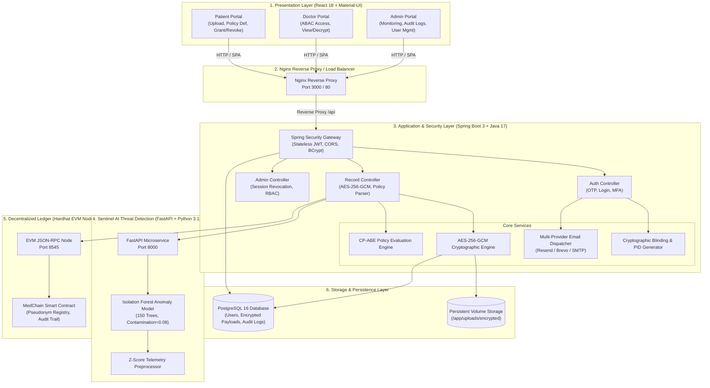
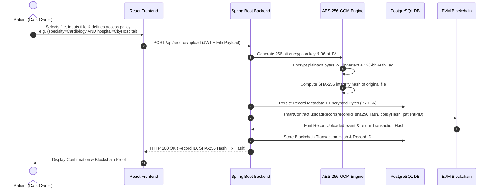
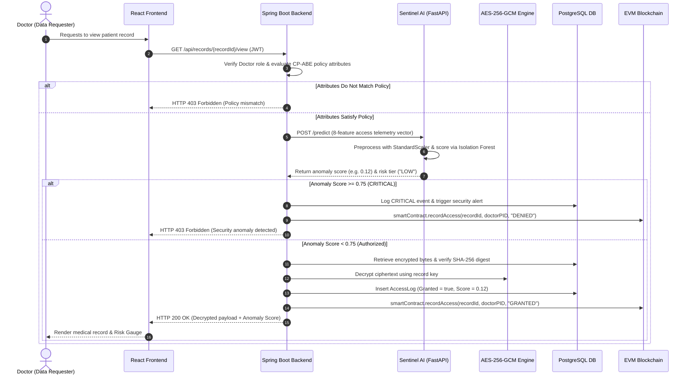

# MedChain — System Architecture & Data Flow Specification

## 1. Executive Summary

**MedChain** is an enterprise-grade, privacy-preserving electronic medical data sharing platform designed to solve the critical vulnerabilities of modern healthcare systems: fragmented medical records, single-point-of-failure centralized databases, unauthorized clinical data access, and insider threats.

MedChain integrates five foundational security paradigms:
1. **Asymmetric Identity Pseudonymization**: Real identities are completely decoupled from on-chain transactions; only cryptographically generated pseudonyms (PIDs) exist on the ledger.
2. **CP-ABE (Ciphertext-Policy Attribute-Based Encryption)**: Fine-grained access control policies (e.g. `(specialty=Cardiology AND hospital=CityHospital) OR (license=Senior)`) govern data decryption.
3. **AES-256-GCM Off-Chain Storage**: Payloads are encrypted using 256-bit symmetric encryption with 128-bit authentication tags and SHA-256 integrity verification.
4. **Hardhat EVM Blockchain Audit Trail**: Smart contracts provide an immutable, non-repudiable audit ledger recording all upload, grant, revoke, and view events.
5. **Sentinel AI (FastAPI Isolation Forest)**: Real-time behavioral anomaly scoring detects credential compromise, abnormal off-hours access, and mass exfiltration.

---

## 2. System Architecture Diagram

---

## 3. End-to-End Data Flow Diagrams

### 3.1. Medical Record Upload & Encryption Flow

### 3.2. Record Access Request & Sentinel AI Threat Evaluation

---

## 4. Key Security & Cryptographic Mechanisms

| Mechanism | Technical Implementation | Purpose |
|---|---|---|
| **Identity Pseudonymization** | $\text{PID} = \text{Keccak-256}(\text{Identity} \parallel \text{Nonce})$ | Prevents patient tracking and profiling on public or consortium ledgers. |
| **Data Encryption at Rest** | AES-256 in Galois/Counter Mode (GCM) | Provides authenticated encryption with non-malleable 128-bit verification tags. |
| **Integrity Verification** | SHA-256 Cryptographic Hash Digest | Guarantees tamper detection before and after file decryption. |
| **Access Control (ABAC)** | Ciphertext-Policy Attribute-Based Encryption | Enforces attribute-based access independent of central storage servers. |
| **Key Delegation** | Proxy Re-Encryption (PRE) Key Transformation | Enables patient to grant access to doctors without revealing their private keys. |
| **Immutable Ledger** | Solidity 0.8.20 Smart Contract on EVM | Provides immutable, tamper-resistant access trails for HIPAA audit compliance. |
| **Anomaly Detection** | Scikit-Learn Isolation Forest ($150$ trees) | Evaluates 8 behavioral dimensions in $<15\text{ms}$ to detect unauthorized harvesting. |
| **Multi-Factor Auth** | 6-Digit BCrypt-Hashed OTP (Resend/Brevo/SMTP) | Prevents brute force credential attacks and enforces single-use verification. |
