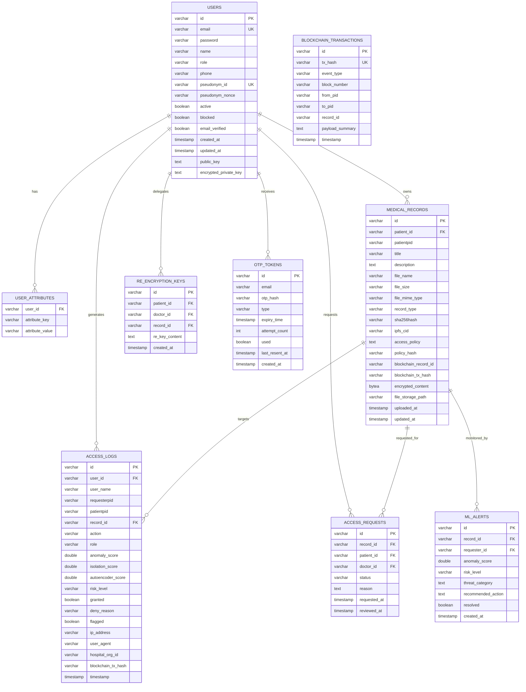

# MedChain — Database Schema & Data Dictionary

## 1. Overview

MedChain uses a high-performance relational database persistence model managed via **Spring Data JPA / Hibernate 6**. The production environment utilizes **PostgreSQL 16**, with an **H2 in-memory/file** fallback for local unit and integration test automation.

Sensitive medical file payloads are encrypted off-chain using **AES-256-GCM** with authenticated 128-bit tags. The encrypted bytes and integrity hashes are stored in PostgreSQL (`encrypted_content`, `sha256hash`) and mirrored to persistent storage volumes to guarantee data survival across container and dyno restarts.

---

## 2. Entity-Relationship Diagram (ERD)

---

## 3. Table Specifications

### 3.1. `users`
Stores user profile information, authentication credentials, and cryptographic pseudonym mapping.

| Column Name | Data Type | Nullable | Constraints / Default | Description |
|---|---|---|---|---|
| `id` | `VARCHAR(255)` | NO | PRIMARY KEY | Unique UUID identifier |
| `email` | `VARCHAR(255)` | NO | UNIQUE | User login email address |
| `password` | `VARCHAR(255)` | NO | | BCrypt password hash ($2a$10$...) |
| `name` | `VARCHAR(255)` | NO | | User full name |
| `role` | `VARCHAR(50)` | NO | | RBAC Role (`PATIENT`, `DOCTOR`, `ADMIN`) |
| `phone` | `VARCHAR(50)` | YES | | Contact telephone number |
| `pseudonym_id` | `VARCHAR(255)` | NO | UNIQUE | On-chain identity pseudonym (SHA3-256) |
| `pseudonym_nonce` | `VARCHAR(255)` | NO | | Cryptographic blinding nonce |
| `active` | `BOOLEAN` | NO | `true` | Account active status (deactivation flag) |
| `blocked` | `BOOLEAN` | NO | `false` | Security block triggered by AI anomalies |
| `email_verified` | `BOOLEAN` | NO | `false` | Email verification flag via 6-digit OTP |
| `public_key` | `TEXT` | YES | | User asymmetric public key for PRE |
| `encrypted_private_key` | `TEXT` | YES | | Asymmetric private key encrypted under password |
| `created_at` | `TIMESTAMP` | NO | | Account creation timestamp |
| `updated_at` | `TIMESTAMP` | YES | | Account modification timestamp |

### 3.2. `user_attributes`
Stores multi-valued attribute sets for doctors used by Ciphertext-Policy Attribute-Based Encryption (CP-ABE).

| Column Name | Data Type | Nullable | Constraints | Description |
|---|---|---|---|---|
| `user_id` | `VARCHAR(255)` | NO | FOREIGN KEY (`users.id`) | Owning user ID |
| `attribute_key` | `VARCHAR(255)` | NO | | Attribute dimension (e.g. `specialty`, `hospital`) |
| `attribute_value` | `VARCHAR(255)` | NO | | Attribute value (e.g. `Cardiology`, `CityHospital`) |

### 3.3. `medical_records`
Stores metadata and encrypted payloads of patient electronic health records.

| Column Name | Data Type | Nullable | Description |
|---|---|---|---|
| `id` | `VARCHAR(255)` | NO (PK) | Unique record UUID |
| `patient_id` | `VARCHAR(255)` | NO (FK) | ID of owning patient (`users.id`) |
| `patientpid` | `VARCHAR(255)` | NO | Pseudonym ID of patient |
| `title` | `VARCHAR(255)` | NO | Clinical record title |
| `description` | `TEXT` | YES | Clinical description or doctor notes |
| `file_name` | `VARCHAR(255)` | NO | Original filename |
| `file_size` | `VARCHAR(50)` | NO | Human-readable size (e.g. `1.5 MB`) |
| `file_mime_type` | `VARCHAR(100)` | NO | MIME type (e.g. `application/pdf`, `image/png`) |
| `record_type` | `VARCHAR(50)` | NO | Category (`LAB_REPORT`, `SCAN`, `PRESCRIPTION`, `DISCHARGE`) |
| `sha256hash` | `VARCHAR(64)` | NO | SHA-256 cryptographic digest of plaintext file |
| `ipfs_cid` | `VARCHAR(255)` | YES | Content Identifier if mirrored to IPFS |
| `access_policy` | `TEXT` | NO | CP-ABE policy expression (e.g. `(specialty=Cardiology)`) |
| `policy_hash` | `VARCHAR(64)` | NO | Cryptographic hash of access policy |
| `blockchain_record_id` | `VARCHAR(255)` | YES | Smart contract on-chain record ID |
| `blockchain_tx_hash` | `VARCHAR(255)` | YES | Ethereum EVM transaction hash anchoring the record |
| `encrypted_content` | `BYTEA` | YES | AES-256-GCM encrypted payload persisted in PostgreSQL |
| `file_storage_path` | `VARCHAR(500)` | YES | Disk storage path on persistent volume |
| `uploaded_at` | `TIMESTAMP` | NO | Record upload timestamp |
| `updated_at` | `TIMESTAMP` | YES | Record modification timestamp |

### 3.4. `access_logs`
Immutable audit trail capturing all system events, access attempts, and Sentinel AI scoring.

| Column Name | Data Type | Description |
|---|---|---|
| `id` | `VARCHAR(255)` (PK) | Audit log UUID |
| `user_id` | `VARCHAR(255)` | ID of user performing action |
| `user_name` | `VARCHAR(255)` | Display name of actor |
| `requesterpid` | `VARCHAR(255)` | On-chain pseudonym of requester |
| `patientpid` | `VARCHAR(255)` | On-chain pseudonym of target patient |
| `record_id` | `VARCHAR(255)` | Associated medical record ID |
| `action` | `VARCHAR(50)` | Action performed (`VIEW`, `UPLOAD`, `GRANT`, `REVOKE`, `LOGIN`) |
| `role` | `VARCHAR(50)` | Role of requester (`PATIENT`, `DOCTOR`, `ADMIN`) |
| `anomaly_score` | `DOUBLE PRECISION` | Composite risk score $[0.0 - 1.0]$ |
| `isolation_score` | `DOUBLE PRECISION` | Isolation Forest anomaly score |
| `autoencoder_score` | `DOUBLE PRECISION` | Reconstruction error score |
| `risk_level` | `VARCHAR(50)` | Risk tier (`LOW`, `MEDIUM`, `HIGH`, `CRITICAL`) |
| `granted` | `BOOLEAN` | Whether access request was authorized |
| `deny_reason` | `VARCHAR(255)` | Reason for denial (`ANOMALY_DETECTED`, `POLICY_MISMATCH`, etc.) |
| `flagged` | `BOOLEAN` | Flagged for security review ($\text{score} > 0.60$) |
| `ip_address` | `VARCHAR(50)` | Client IPv4/IPv6 address |
| `user_agent` | `VARCHAR(255)` | Browser user agent string |
| `hospital_org_id` | `VARCHAR(100)` | Requesting healthcare organization |
| `blockchain_tx_hash` | `VARCHAR(255)` | On-chain audit trail transaction hash |
| `timestamp` | `TIMESTAMP` | Precise event timestamp |

### 3.5. `otp_tokens`
Ephemeral security token store for multi-factor registration and password reset verification.

| Column Name | Data Type | Description |
|---|---|---|
| `id` | `VARCHAR(255)` (PK) | Token UUID |
| `email` | `VARCHAR(255)` | Recipient email address |
| `otp_hash` | `VARCHAR(255)` | BCrypt hash of 6-digit random code |
| `type` | `VARCHAR(50)` | Type (`REGISTRATION`, `PASSWORD_RESET`) |
| `expiry_time` | `TIMESTAMP` | Expiration time (strictly 5 minutes from creation) |
| `attempt_count` | `INT` | Failed verification attempts (max 3) |
| `used` | `BOOLEAN` | Invalidation flag once consumed |
| `last_resent_at` | `TIMESTAMP` | Cooldown enforcement timestamp (60s minimum interval) |
| `created_at` | `TIMESTAMP` | Token creation timestamp |

---

## 4. Security & Compliance Indexing

To guarantee sub-second querying and enforce relational integrity:
1. `users(email)`: Unique B-Tree index for $O(1)$ login lookup.
2. `users(pseudonym_id)`: Unique index ensuring strict $1:1$ pseudonym mapping.
3. `medical_records(patient_id)`: Foreign key index for patient dashboard retrieval.
4. `access_logs(timestamp DESC)`: Time-series index for real-time monitoring and reporting.
5. `otp_tokens(email, type, used)`: Composite index for fast active OTP resolution.
